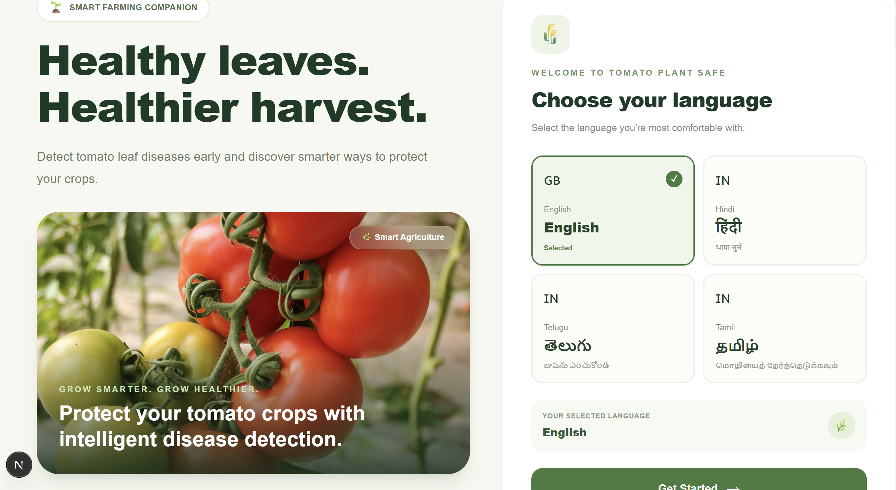
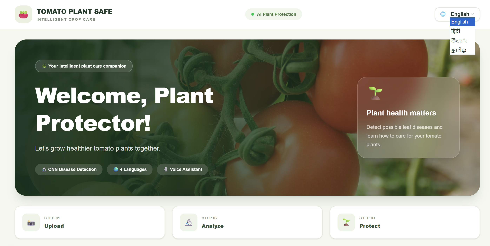
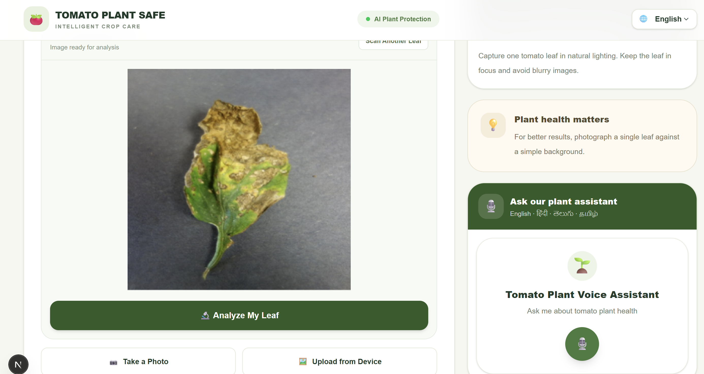

# 🍅 Tomato Leaf Disease Detection System Using CNN

An AI-powered agricultural web application designed to identify tomato leaf diseases using Deep Learning. The system combines a two-stage image classification architecture with a multilingual farmer-friendly interface to provide preliminary disease identification and relevant preventive guidance.

### 1. Landing Page


### 2. Dashboard


### 3. Image Upload


---

## 📌 Project Overview

Tomato plants are affected by several diseases that can reduce crop quality and agricultural productivity. Early identification of these diseases can help farmers take appropriate preventive measures.

The **Tomato Leaf Disease Detection System** aims to make preliminary disease identification easier by allowing users to upload or capture an image of a tomato leaf and receive a classification result.

The system uses two deep learning models:

- **Stage 1:** Custom Convolutional Neural Network (CNN) for Tomato vs Non-Tomato classification.
- **Stage 2:** EfficientNet-B0 for classifying tomato leaf images into ten categories.

The application also provides disease-related information, including possible causes, symptoms, precautions, and recommended actions.

---

## ✨ Key Features

### 🌱 Deep Learning-Based Disease Detection
- Two-stage image classification architecture.
- Tomato and non-tomato image identification.
- Classification into ten tomato leaf categories.
- Confidence-based prediction handling.

### 📷 Image Processing
- Upload images from a device.
- Capture images using compatible cameras.
- Preview images before analysis.
- Image validation and preprocessing.

### 🌍 Multilingual Support
The application supports four languages:

- English
- Hindi
- Telugu
- Tamil

### 🩺 Disease Information and Guidance
- Possible disease causes.
- Common symptoms.
- Preventive measures.
- Recommended actions.

### 🎤 Voice Interaction
- Basic speech recognition.
- Speech output using browser-supported speech synthesis.
- Language-dependent voice settings where supported by the browser.

### 🤖 AI-Powered Farmer Support Assistant — Future Enhancement

A conversational AI assistant is planned to help farmers understand plant diseases and obtain relevant information.

Planned capabilities include:

- Answering questions about tomato leaf diseases.
- Explaining symptoms and possible causes.
- Explaining detected disease results.
- Providing general preventive guidance.
- Supporting English, Hindi, Telugu, and Tamil.
- Conversational voice-based interaction.

**Current status:** Basic speech recognition and speech output are implemented. Full conversational AI integration is planned.

---

## 🧠 Deep Learning Architecture

The system follows a two-stage classification approach.

### Stage 1: Custom CNN — Tomato Identification

A custom Convolutional Neural Network is used for binary classification.

The two output categories are:

- Tomato
- Non-Tomato

This stage checks whether the uploaded image belongs to the intended crop category before proceeding to disease classification.

**Internal Test Accuracy: 99.11%**

### Stage 2: EfficientNet-B0 — Disease Classification

EfficientNet-B0 is used to classify tomato leaf images into ten categories.

Supported categories:

1. Bacterial Spot
2. Early Blight
3. Healthy
4. Late Blight
5. Leaf Mold
6. Septoria Leaf Spot
7. Spider Mites
8. Target Spot
9. Tomato Mosaic Virus
10. Yellow Leaf Curl Virus

**Internal Test Accuracy: 98.48%**

**Internal Macro F1-Score: 97.63%**

### Confidence Threshold

A confidence threshold of **0.90** is configured in the prediction pipeline.

If a prediction does not meet the configured threshold, the system can return an uncertain result rather than accepting a low-confidence classification.

A confidence score should not be interpreted as a guaranteed probability of correctness.

---

## 🏗️ System Architecture

The application follows this workflow:

1. User opens the application and selects a preferred language.
2. User uploads or captures a tomato leaf image.
3. The Next.js frontend sends the image to the FastAPI backend.
4. Stage 1 CNN checks whether the image is classified as Tomato or Non-Tomato.
5. If accepted, Stage 2 EfficientNet-B0 performs classification.
6. Backend returns the prediction and confidence information.
7. Frontend displays the result and corresponding disease information.
8. Users can access available voice functionality and multilingual guidance.

---

## 🛠️ Technology Stack

| Component | Technology |
|---|---|
| Frontend Framework | Next.js |
| UI Library | React |
| Programming Language | TypeScript |
| Styling | Tailwind CSS |
| Backend | Python |
| API Framework | FastAPI |
| Deep Learning Framework | PyTorch |
| First Model | Custom CNN |
| Second Model | EfficientNet-B0 |
| ASGI Server | Uvicorn |
| Speech Features | Web Speech APIs |

---

## 📂 Project Structure

```text
TomatoDiseaseProject/
│
├── Datasets/
│
├── Models/
│   └── inference/
│       ├── stage1_cnn_inference.pth
│       ├── stage2_efficientnet_b0_inference.pth
│       └── class_labels.json
│
├── Scripts/
│
├── ml_service/
│   ├── app/
│   │   ├── main.py
│   │   ├── model_loader.py
│   │   └── predictor.py
│   │
│   ├── requirements.txt
│   └── .venv/
│
├── frontend/
│   ├── app/
│   │   ├── page.tsx
│   │   ├── home/
│   │   │   └── page.tsx
│   │   └── globals.css
│   │
│   ├── data/
│   │   └── diseaseInfo.ts
│   │
│   ├── public/
│   └── package.json
│
└── README.md
```

---

## 📊 Dataset Information

The project uses the PlantVillage and PlantDoc datasets for plant leaf image classification and evaluation.

- **PlantVillage:** Used as a source of labeled plant leaf images.
- **PlantDoc:** Used as an additional source of plant disease images and for external evaluation.

The datasets were subjected to image quality checks and preparation before model development.

Dataset availability and usage should follow the respective dataset licenses and terms.

---

## 📈 Model Evaluation Results

The models were evaluated using internal test data. The Stage 2 model was additionally evaluated on an external PlantDoc sample.

| Model | Evaluation | Result |
|---|---|---:|
| Custom CNN | Internal test accuracy | 99.11% |
| EfficientNet-B0 | Internal test accuracy | 98.48% |
| EfficientNet-B0 | Internal macro F1-score | 97.63% |
| EfficientNet-B0 | External PlantDoc accuracy (79 images) | 64.56% |
| EfficientNet-B0 | External PlantDoc macro F1-score | 62.25% |

**Observation:** The external evaluation results are lower than the internal test results. This indicates a generalization challenge when processing images from different sources, backgrounds, lighting conditions, and image qualities.

Further training and evaluation using diverse real-world agricultural images are required to improve reliability.

---

## ⚙️ Installation and Setup

### Prerequisites

Install the following:

- Python 3.10 or a compatible version for the project dependencies.
- Node.js and npm.
- Git.
- VS Code (recommended).

### Step 1: Clone the Repository

```bash
git clone YOUR_GITHUB_REPOSITORY_URL
```

Navigate into the project:

```bash
cd TomatoDiseaseProject
```

### Step 2: Set Up the Backend

Navigate to the backend directory:

```bash
cd ml_service
```

Create a virtual environment:

```bash
python -m venv .venv
```

Activate it on Windows:

```bash
.venv\Scripts\activate
```

Install dependencies:

```bash
pip install -r requirements.txt
```

### Step 3: Add the Trained Models

Place the trained model files inside:

```text
Models/inference/
```

Required files:

```text
stage1_cnn_inference.pth
stage2_efficientnet_b0_inference.pth
class_labels.json
```

**Important:** Model weights and dataset files are not included in the Git repository. They must be obtained separately and placed in the expected directory before running the backend.

### Step 4: Run the Backend

From the `ml_service` directory, execute:

```bash
python -m uvicorn app.main:app --reload --host 127.0.0.1 --port 8000
```

Backend URL:

```text
http://127.0.0.1:8000
```

API Documentation:

```text
http://127.0.0.1:8000/docs
```

Health Check:

```text
http://127.0.0.1:8000/health
```

### Step 5: Set Up the Frontend

Open a new terminal and navigate to the frontend directory:

```bash
cd frontend
```

Install dependencies:

```bash
npm install
```

Start the frontend:

```bash
npm run dev
```

Open the application:

```text
http://localhost:3000
```

**Note:** Keep both the frontend and backend servers running while using the application. The frontend API URL must point to the running backend.

---

## 🔌 API Endpoints

| Method | Endpoint | Description |
|---|---|---|
| GET | `/health` | Checks backend and model status |
| POST | `/predict` | Accepts an image and returns its prediction |

The `/predict` endpoint accepts an image through multipart form data.

### Example Prediction Response

```json
{
  "status": "success",
  "disease": "Early_Blight",
  "confidence": 0.997,
  "stage1_confidence": 0.9934
}
```

---

## 🔮 Future Enhancements

The following improvements are planned for future versions:

1. Integration of a conversational multilingual AI farmer support assistant.
2. Real-time camera-based tomato leaf disease detection.
3. Progressive Web App (PWA) and Android application.
4. Offline image classification for areas with limited connectivity.
5. Improved model generalization using diverse agricultural datasets.
6. Support for additional crops and plant diseases.
7. Agricultural expert validation of disease-related guidance.
8. Enhanced voice-based interaction in regional languages.

---

## ⚠️ Limitations

- External dataset performance requires improvement.
- Prediction quality can be affected by lighting, background, and image quality.
- The confidence threshold does not guarantee prediction correctness.
- The current voice feature is not a fully conversational AI assistant.
- The application provides preliminary disease information and does not replace professional agricultural diagnosis.

---

## 🎯 Project Objective

The objective of this project is to demonstrate how deep learning and modern web technologies can be integrated to develop an accessible agricultural image-classification system.

By combining a two-stage CNN-based classification pipeline, a FastAPI backend, and a multilingual web interface, the project aims to make preliminary tomato leaf disease identification easier and more accessible.

---

## 👨‍💻 Author

**Sai Chakri Edubilli**

B.Tech – Computer Science and Engineering

GitHub: [saichakri1122](https://github.com/saichakri1122)

---

⭐ If you find this project interesting, consider giving the repository a star!
